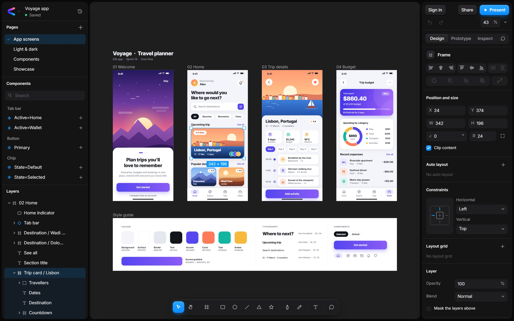
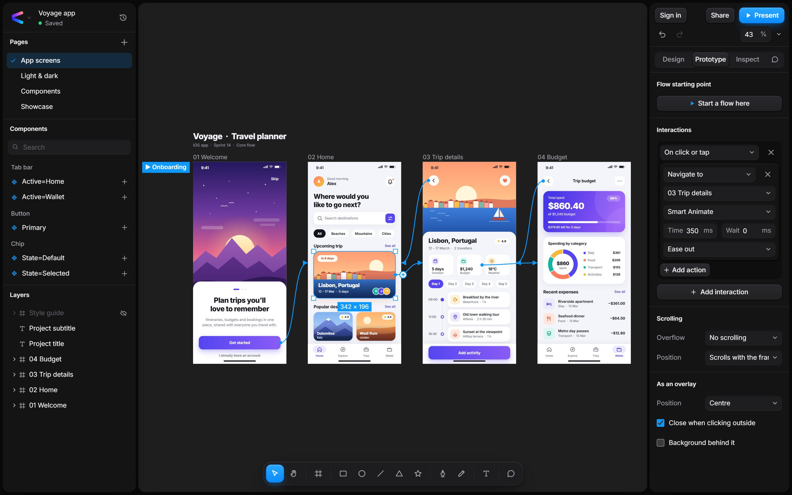
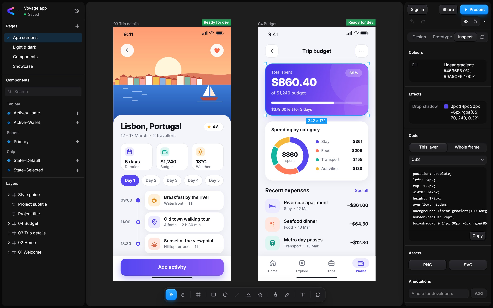
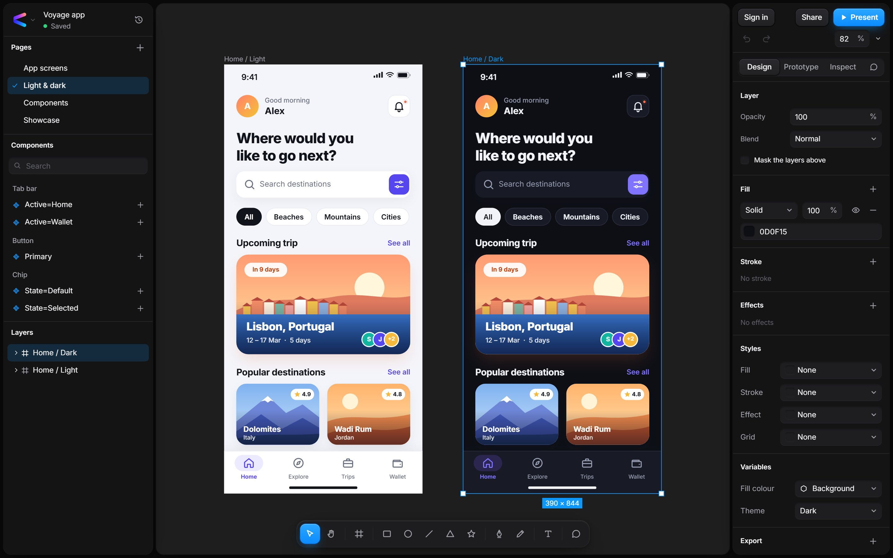

<p align="center">
  
</p>

<h1 align="center">Evora</h1>

<p align="center">
  <b>Design, prototype and build together. Free, open and yours.</b>
</p>

<p align="center">
  A real desktop app for Windows, macOS and Linux that <b>works offline</b>, with <b>free real-time teamwork</b>,<br />
  <b>opens your Figma <code>.fig</code> files</b>, and <b>lets your AI agent design with you</b>. Nothing behind a paywall.
</p>

<p align="center">
  <a href="LICENSE"></a>
  
  
  
</p>

<p align="center">
  <a href="https://shishirshastry.github.io/evora/"><b>Website</b></a> &middot;
  <a href="https://shishirshastry.github.io/evora/#download"><b>Download for Windows, macOS and Linux</b></a> &middot;
  <a href="docs/user-guide.md"><b>User guide</b></a> &middot;
  <a href="docs/mcp.md"><b>Design with your AI agent</b></a>
</p>

<p align="center">
  <a href="https://shishirshastry.github.io/evora/"></a>
</p>

---

Evora is where screens, flows and design systems come to life. Sketch an idea, shape it with real layout and components, click through it as a working prototype, and hand it to developers, alone or with your whole team on the same canvas at once.

It is **free for everyone, for good**: no plans, no seats to count, no "upgrade to unlock". Your files live on **your** device, work offline, and can be shared through a server **you** run. And because it is open source, you can see how it works, change it, and extend it with plugins.

## Why Evora

| | |
|---|---|
| **Everything included** | Vectors, layout, components, variables, prototyping, developer handoff, collaboration, version history and plugins. All of it, for everyone. |
| **Truly collaborative** | Edit together live with cursors, comments and @mentions. Invite as many people as you like; every seat is free. |
| **Yours to keep** | Local-first: files stay on your device and keep working offline. Host your own team server with one command. No lock-in. |
| **Fast on big files** | A canvas renderer built for the job, and a layers panel that stays quick with thousands of layers. |
| **Made to be extended** | Sandboxed plugins and live widgets with a documented API, plus a community library of templates and UI kits. |
| **Open source** | MIT licensed. Read the code, fork it, improve it. |

## What you can do

**🎨 Design anything.** Frames, shapes, pen and pencil, boolean shapes that stay editable, rich text with any font, gradients, image fills, shadows, blurs and blend modes, on an infinite canvas with smart guides, snapping and measurements.

**📐 Lay out like real code.** Responsive auto layout with wrapping rows and columns, padding, gaps, hug and fill sizing, constraints and nesting: designs that resize the way the finished product will.

**🧩 Build design systems.** Components and variants with overrides, component properties, colour, text and effect styles, and variables with modes for themes such as light and dark. Publish a library and reuse it across files.

**▶️ Prototype interactions.** Link screens with clicks, hovers, key presses and timers; open overlays, scroll, switch component states, set variables and branch on conditions; animate between screens with smart transitions; present on phone, tablet or desktop frames.

**👩‍💻 Hand off to developers.** Inspect any layer, copy CSS, SwiftUI or Jetpack Compose code, export assets as PNG, JPG, SVG or PDF, and mark what is ready to build.

**🤝 Work as a team.** Workspaces, roles and share links (guests welcome), live co-editing that merges even offline changes, cursors, following, and comments pinned to the canvas.

**🕓 Never lose work.** Automatic and named versions, side-by-side and overlay comparison, one-click restore, and branches you can merge back with every conflict laid out for you.

**🔌 Extend it.** Install plugins that run safely in a sandbox with only the permissions you grant, drop interactive widgets on the canvas, and browse the community library for templates, UI kits and icon sets.

**📂 Bring your work with you.** Open `.fig` and SVG files as fully editable layers, and save your work as an open `.evora` file.

<p align="center">
  
  
  
</p>

## Get Evora

### 💻 Desktop app (Windows, macOS, Linux)

A native app that works fully offline, opens and saves files on disk, recovers your work after a crash, keeps itself up to date once releases are published, and can host a team server for your office.

| Your system | Download |
|---|---|
| **Windows** 10 and 11 (64-bit) | [Installer (.exe)](https://github.com/ShishirShastry/evora/releases/download/v0.2.0/Evora-Setup-0.2.0.exe) · [Portable, no install (.exe)](https://github.com/ShishirShastry/evora/releases/download/v0.2.0/Evora-0.2.0-portable.exe) |
| **macOS** 13 or later, Apple silicon (M1 and later) | [Disk image (.dmg)](https://github.com/ShishirShastry/evora/releases/download/v0.2.0/Evora-0.2.0-arm64.dmg) · [.zip](https://github.com/ShishirShastry/evora/releases/download/v0.2.0/Evora-0.2.0-mac-arm64.zip) |
| **macOS** 13 or later, Intel | [Disk image (.dmg)](https://github.com/ShishirShastry/evora/releases/download/v0.2.0/Evora-0.2.0-x64.dmg) · [.zip](https://github.com/ShishirShastry/evora/releases/download/v0.2.0/Evora-0.2.0-mac-x64.zip) |
| **Linux** (64-bit, x86-64) | [AppImage, any distribution](https://github.com/ShishirShastry/evora/releases/download/v0.2.0/Evora-0.2.0-x86_64.AppImage) · [Debian and Ubuntu (.deb)](https://github.com/ShishirShastry/evora/releases/download/v0.2.0/evora_0.2.0_amd64.deb) |

Not sure which Mac you have? Apple menu → **About This Mac**: a **Chip** such as Apple M1–M4 means Apple silicon; an Intel **Processor** means Intel. Every version is on the **[Releases page](https://github.com/ShishirShastry/evora/releases/latest)**.

#### Installing

- **Windows:** run the installer. Evora isn't code-signed yet, so SmartScreen may say "Windows protected your PC": choose **More info → Run anyway**. The portable `.exe` runs without installing. Or install it with [winget](https://learn.microsoft.com/windows/package-manager/), which doesn't show that warning:

  ```powershell
  winget install ShishirShastry.Evora
  ```
- **macOS:** open the `.dmg` and drag **Evora** into **Applications**. Evora isn't signed by Apple yet, so the first time you open it macOS says it can't verify the app: choose **Done**, then go to **System Settings → Privacy & Security** and choose **Open Anyway**. You only do this once. Automatic updates need a signed app, so on a Mac download each new version from here.
- **Linux (AppImage):** make it executable and run it; it updates itself.

  ```bash
  chmod +x Evora-*.AppImage
  ./Evora-*.AppImage
  ```

- **Linux (.deb):** install it with apt, which also pulls in anything it needs. Evora then appears in your applications menu.

  ```bash
  sudo apt install ./evora_*_amd64.deb
  ```

Every installer is built in public by [GitHub Actions](.github/workflows/release.yml) from this repository's code. [More about the desktop app](electron/README.md).

### 🤖 With your AI agent

Claude Code, Cursor, Claude Desktop, VS Code and other AI agents can create and edit Evora designs through Evora's MCP server. Download `evora-mcp.mjs` from the [latest release](https://github.com/ShishirShastry/evora/releases/latest) (it needs Node.js 20 or later), then, for Claude Code:

```bash
claude mcp add evora -- node /path/to/evora-mcp.mjs --root ~/Designs
```

Ask for a screen or a whole flow, then open the file in Evora to refine it. Setup for other agents and the full list of tools: [docs/mcp.md](docs/mcp.md).

### 🌐 In your browser

You need [Node.js](https://nodejs.org) 24.

```bash
npm install
npm run dev
```

Open http://localhost:5173 and start designing. No account, no server: files are kept on your device.

### 👥 With your team

Start the collaboration server beside the app:

```bash
npm run server
```

```bash
npm run dev
```

Sign up, then invite your team to a workspace or share a file by link.

### 🏢 Self-host for everyone

One process serves both the app and the collaboration server:

```bash
npm start
```

It runs at http://localhost:8787. For Docker, systemd, HTTPS behind nginx or Caddy, backups and every setting, see the **[self-hosting guide](docs/self-hosting.md)**.

<details>
<summary><b>Sign in with Google (optional)</b></summary>

1. In Google Cloud Console, set up the OAuth consent screen (scopes `openid`, `email`, `profile`).
2. Create an OAuth client ID of type **Web application** with the redirect URI `<app address>/api/auth/google/callback`, for example `http://localhost:5173/api/auth/google/callback`.
3. Start the server with `EVORA_GOOGLE_CLIENT_ID` and `EVORA_GOOGLE_CLIENT_SECRET` (and `EVORA_PUBLIC_URL` for an address other than localhost). Never commit these values.

</details>

## Where Evora is today

Evora is young and moving fast. The editor, design systems, prototyping, handoff, collaboration, version history, plugins and community library are built, and more than eleven hundred automated tests and dozens of real-browser tests check them. The desktop app and self-hosting arrived with the **first public release, 0.1.0**. Every known gap is listed openly in [HANDOFF.md](HANDOFF.md).

**Coming next:** signed installers, a VS Code extension and public REST API, and integrations with GitHub, Storybook and Jira. Also on the list: text on a path, variable-width strokes, video in prototypes, and audio and cursor chat.

## Build with us

Evora is open source and contributions are welcome: bug reports, ideas, plugins, and code. Start with [CONTRIBUTING.md](CONTRIBUTING.md), pick up a [good first issue](https://github.com/ShishirShastry/evora/labels/good%20first%20issue), or say hello in [Discussions](https://github.com/ShishirShastry/evora/discussions).

If Evora is useful to you, **a star on GitHub helps other people find it.**

- **Write a plugin:** [plugin guide](plugins/PLUGINS.md), with four examples in [plugins/examples](plugins/examples).
- **Report a security issue:** [SECURITY.md](SECURITY.md).
- **Ship a release:** [RELEASING.md](RELEASING.md) and [CHANGELOG.md](CHANGELOG.md).
- **Learn Evora:** the [user guide](docs/user-guide.md), with every keyboard shortcut.
- **Integrate with it:** the [API reference](docs/api.md) for the server's HTTP and live-editing protocol.
- **Understand the code:** [architecture](PROJECT_ARCHITECTURE.md), [file format](DOCUMENT_SCHEMA.md), [product specification](EVORA_MASTER_SPEC.md) and the [handoff notes](HANDOFF.md).

<details>
<summary><b>Checks</b></summary>

```bash
npm run typecheck      # TypeScript: the app, the tooling, the server and the desktop app
npm test               # unit tests (Vitest), the server's included
npm run e2e            # browser tests (Playwright, Microsoft Edge)
npm run build          # production build into dist/
npm run desktop        # the desktop app in development
npm run dist:desktop   # desktop installers for this system, into release/
```

</details>

<details>
<summary><b>Project layout</b></summary>

| Folder | What it holds |
|---|---|
| `src/core` | The document model and every operation on it, file import and export, layout, text, vectors and prototyping logic. Pure TypeScript. |
| `src/engine` | The canvas renderer, overlays, viewport, interaction tools, and SVG, PDF and PNG export. |
| `src/state` | The editor store (document, selection, per-person undo) and the command table behind menus and shortcuts. |
| `src/persistence` | Local storage, autosave, file import and export, and the desktop bridge. |
| `src/collab` | The sync protocol, the sync engine, the offline queue and the API client. |
| `src/plugins` | The plugin runtime: manifests, the sandbox, the `evora.*` API and widgets. |
| `src/ui` | The interface: file browser, editor, panels, dialogs, collaboration, version history, plugins and community. |
| `server` | The collaboration server: API, live rooms, accounts, sharing, comments, versions, plugins and community. Node built-ins only. |
| `electron` | The desktop app: windows, menus, files on disk, updates. |
| `plugins` | The plugin guide and examples. |
| `deploy`, `docs` | Self-hosting files, the user guide, the API reference and other guides. |
| `scripts` | Small tools, such as the one that writes the shortcut table in the user guide. |
| `e2e` | Browser and desktop tests. |
| `.github` | Continuous integration and the release workflow. |

</details>

## Licence

Evora is released under the [MIT License](LICENSE). The bundled Inter font is under the SIL Open Font License 1.1; see [THIRD_PARTY_NOTICES.md](THIRD_PARTY_NOTICES.md).

<sub>Evora is an independent project, not affiliated with or endorsed by any other design tool's maker. Other product names and file formats mentioned belong to their owners.</sub>
